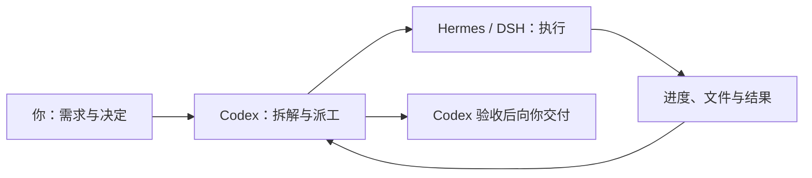

# Codex to Agents

**让 Codex 指挥 agents 干活。**

在 Codex 里提需求，把具体工作交给 **Hermes** 或 **DeepSeek Harness（DSH）**，再回到同一个会话查看进度、继续追问、验收产物。

你控制派工开关和执行端，Codex 负责拆解与验收，Agent 负责实际执行。需要派工时，在 Codex 左侧的 **Agents 看板**打开开关；关闭后，继续按原来的方式使用 Codex。

> 「SOL 规划、DSH 或 Hermes 实现代码」这种模式的实际效果**暂未验证**。

[分工与选型](#分工与选型) · [安装与接入](#安装与接入) · [第一次派工](#第一次派工) · [日常使用](#日常使用) · [常见问题](#常见问题) · [未来方向](#未来方向) · [进阶手册](docs/advanced.md)

## 它帮你完成什么

当你已经在使用 Codex 和另一个 Agent 时，可以把需求下发、进度跟踪和结果回传接起来，减少在工具之间复制粘贴。

| 你要做的事 | 使用方式 |
|---|---|
| 把明确的编程任务交给 Agent | 在 Codex 说明目标、目录和验收条件，由它派发任务 |
| 随时决定是否派工 | 在看板切换「自动派工」，选择 Hermes 或 DSH |
| 知道任务卡在哪里 | 看板展示执行端状态、最近任务、进度和结果摘要 |
| 接着已有任务修改 | 在 Codex 继续提要求，沿用原生 Agent 会话 |
| 检查交付是否可用 | Codex 读取结果，核对文件并运行相应验证 |



讨论、方案比较和代码解释可以直接在 Codex 完成。需要实际写代码、修复问题或运行测试时，再打开派工。

## 分工与选型

### SOL 负责规划与验收

SOL 在 Codex 中承担主控角色，先把执行前的关键决策做清楚，再把具体工作交给执行 Agent。期望通过规划减少歧义与返工：

- **明确边界**：把需求转成具体目标、允许修改的范围和必须保留的行为。
- **降低执行难度**：给出实现步骤、异常场景和验收条件，让执行端少猜业务含义。
- **协调跨模块修改**：先确定接口、数据约定和修改顺序，减少各自实现造成的冲突。
- **持续检查交付**：保留需求上下文，核对文件和运行结果，再安排必要修复。

例如“加一个取消按钮”，规划阶段先明确取消当前任务还是连排队任务一起取消、如何确认停止，执行端据此实现。简单修改可以直接完成，是否派工由用户开关与具体任务决定。

### 执行端要快、量大、能力达标

执行端的选型目标是：**极致的快、量大管饱、中等偏上的实现能力。**

| 要求 | 具体看什么 |
|---|---|
| 快 | 启动、读代码、工具调用、修改和验证的完整交付时间 |
| 量大管饱 | 调用成本、可用额度、持续吞吐与并发稳定性 |
| 能力达标 | 理解明确方案、修改多个文件、正确使用工具，并根据测试结果自行修复 |

DSH 与 Hermes 提供执行框架，实际速度、额度和代码能力还取决于接入的模型与提供方。

这套分工的目标是 **SOL 做少量关键决策，执行 Agent 高频交付合格代码**。衡量时看单位时间、单位成本完成的合格任务数；实际效果暂未验证。

## 安装与接入

### 1. 准备环境

本教程面向 macOS 本机桌面工作流。开始前需要：

- **Node.js 22.19+** 和 npm。
- **Codex 桌面端及 CLI**；桌面端需支持插件、MCP Apps 看板和插件 Hook。
- **Hermes Agent CN Desktop 或 DSH 桌面端**，至少一个已配置模型，且能在原生界面正常聊天。

模型账号和用量由执行端管理。首次使用自动派工，需要在 Codex 审核并信任插件 Hook；开关默认关闭。

```bash
git clone https://github.com/heystarlink/codex-to-agents.git
cd codex-to-agents
npm ci
mkdir -p "$HOME/codex-agents-demo"
```

下面的两条接入路线任选一条，也可以分别启用两者。安装完成后请保留仓库目录和 Node 可执行文件，插件运行时会用到它们。

### 2. 连接执行端

**使用 Hermes**

先打开 Hermes，确认可以正常聊天，再在本仓库目录运行：

```bash
node src/command.mjs enable --executor hermes \
  --directory "$HOME/codex-agents-demo"
```

默认连接本机 `http://127.0.0.1:9120`，使用 Hermes 当前默认模型。其他端口和模型限制见[进阶配置](docs/advanced.md#配置执行端)。

**使用 DSH**

先打开 DSH。下面以已有提供方 ID `deepseek-account` 为例；如果你的提供方 ID 不同，请替换为 DSH 中实际配置的 ID。

```bash
node src/command.mjs enable --provider deepseek-account \
  --directory "$HOME/codex-agents-demo"
```

命令会为 DSH 安装本地执行插件。若插件没有自动加载，重启 DSH。

两条路线都会备份配置并注册派工连接；已有另一执行端的配置会保留。遇到 `codex` 命令找不到时，先看[如何指定 Codex CLI](#找不到-codex-命令怎么办)。

### 3. 安装 Agents 看板

```bash
node src/command.mjs plugin-install
```

安装后：

1. 重启 Codex，让客户端载入插件和连接配置。
2. 按 Codex 的提示审核并信任 **Agents 看板**的 `UserPromptSubmit` Hook，然后新建会话。
3. 从左侧打开 **Agents 看板**，选择刚接入的 **Hermes** 或 **DSH**。
4. 打开 **自动派工**。设置保存后，从下一条消息生效。

看板用于开关派工和查看状态；首次信任 Hook 后，日常切换无需重启，也无需每次重复说“调用 Agent”。具体是否派工仍由 Codex 结合任务和当前指令判断。

## 第一次派工

先用一个可以直接核对结果的小任务走通流程。在已开启自动派工的 Codex 新会话中发送：

```text
在接入时配置的默认任务目录中创建 hello.js，运行后输出 Hello, World!。
只修改 hello.js。请交给所选 Agent 实现，完成后检查文件并实际运行验证，告诉我结果。
```

任务会经历三个阶段：

1. **Codex 安排工作**：检查所选执行端，限定任务范围并保存工作单。
2. **Agent 实际执行**：在 Hermes 或 DSH 中创建原生会话，执行任务并回传进度。
3. **Codex 检查交付**：核对文件和运行结果，再向你报告完成情况。

完成后，你可以在看板查看最近任务，在执行端查看原生聊天，也可以自己验证：

```bash
node "$HOME/codex-agents-demo/hello.js"
```

预期输出：

```text
Hello, World!
```

**「已提交」表示任务已保存；实际成功要看文件、执行输出和验收结果。** 如果任务持续执行中或失败，按[任务没有完成时怎么查](#任务没有完成时怎么查)检查。

接着在同一个 Codex 会话中发送：

```text
继续刚才的任务，把输出改为 Hello, Agents!，仍然只修改 hello.js，并重新运行验证。
```

Codex 可以把补充要求送到原来的 Agent 会话，保留已有上下文。

## 日常使用

### 自己决定什么时候派工

| 开关状态 | 后续行为 |
|---|---|
| 开启 | Codex 按所选执行端的派工偏好处理编程、修复和测试任务；问答与规划直接处理 |
| 关闭 | Codex 停止主动派发新任务，已提交的工作继续跟进 |
| 关闭，但你明确指定 Agent | 仍可以按你的明确要求调用该 Agent |

开关与执行端选择对**共用同一数据目录的 Codex 会话**生效。当前没有每个会话单独保存的开关。切换执行端不会迁移已经提交的任务。

只想临时调用一次时，保持开关关闭，直接说：

```text
调用 Hermes，在接入时配置的默认任务目录创建 hello.js，输出 Hello, World!。
只修改这个文件，完成后请检查并运行它。
```

### 查看、补充或停止任务

你可以在 Codex 里直接说：

| 目的 | 示例消息 |
|---|---|
| 查进度 | 「查看刚才任务的状态，告诉我当前进度和是否需要我处理。」 |
| 补充要求 | 「继续刚才的任务，补一个边界条件测试，再运行相关测试。」 |
| 请求停止 | 「请求取消刚才的任务，并确认执行端是否已经停止。」 |
| 找到原生聊天 | 「给我刚才任务对应的执行端和原生会话 ID。」 |

关闭自动派工、关闭看板或关闭 Codex 会话，都不会向执行端发送取消指令。需要停止工作时，明确请求取消并检查结果。

### 多个会话一起使用

同一数据目录下，派工连接和看板共用一个 **`agents-backend`** 后台。打开多个会话不会各自再启动一套执行后台。

看板隐藏时暂停界面查询，恢复显示后立即更新；任务继续在后台执行。Hermes 执行模块在有待处理工作或查询运行时信息时加载，单纯打开看板不会唤起它。

在 macOS 活动监视器中搜索 `agents-backend`，即可找到常驻服务；看板底部也显示名称、PID 和 RSS 内存。实际占用随模块加载和任务数量变化。`agents-hook` 是读取开关或连接认证时的短暂进程。

## 常见问题

### 找不到 Codex 命令怎么办

`enable` 和 `plugin-install` 都支持 `--codex`，用于指定 CLI 可执行文件。若你的 macOS 安装位置与下列路径一致，Hermes 路线可以这样运行：

```bash
node src/command.mjs enable --executor hermes \
  --directory "$HOME/codex-agents-demo" \
  --codex "/Applications/ChatGPT.app/Contents/Resources/codex-cli/CodexCLI.app/Contents/MacOS/codex"

node src/command.mjs plugin-install \
  --codex "/Applications/ChatGPT.app/Contents/Resources/codex-cli/CodexCLI.app/Contents/MacOS/codex"
```

安装位置不同则使用实际路径；DSH 接入命令也可追加同一个 `--codex` 参数。

### 看板已安装，但没有入口或没有自动派工

先重启 Codex。看板能打开、能保存开关，只说明界面和设置可用；自动派工还需要信任插件 Hook，并在此后新建会话。确认开关已开启，执行端也选对了。

### 执行端显示离线怎么办

先确认 Hermes 或 DSH 已打开，且在原生界面可以正常聊天。Hermes 尚未按需加载时，看板可能显示离线；可以让 Codex 检查连接而不提交任务：

```text
检查 Hermes 的连接状态和可用模型目录，不要提交任务。
```

如果仍离线，再查看后台与执行端状态：

```bash
node src/command.mjs backend status
node src/command.mjs status
```

后台在线与执行端在线是两件事。DSH 需要已加载执行插件，Hermes 需要其本机 Dashboard 可连接。

### 任务没有完成时怎么查

先在看板或 Codex 中查看原任务，再打开对应原生聊天，确认是否等待权限、用户输入或模型响应。模型调用超时也可能表现为长时间执行中。

工作单已保存并不代表执行端已经成功完成。若状态为 `uncertain`（待核查），先检查原生记录和实际文件；使用原工作单编号查询，避免重新派发同一份变更。

### 为什么在 Hermes 或 DSH 看不到聊天

让 Codex 提供任务的 `conversation_id`，它是原生会话编号，与工作单编号不同。确认执行端一致，再刷新对话历史；Hermes 侧栏未更新时，可以切换页面后返回工作台。归档的聊天需在对应归档列表中查找。

### 为什么 MCP 里有两个连接

`codex-to-agents` 提供派工工具，插件的 `agents_board` 提供看板和设置工具。它们连接同一个后台，连接条目数不等于常驻进程数。

## 当前范围与验证

当前支持 **DSH 桌面端**和 **Hermes Agent CN Desktop**，通过本机工作单保存任务、进度和结果。支持目录、模型选择、同会话追问，以及聊天列表、改名、归档和恢复；桌面项目注册由 DSH 提供。

已核对环境为 macOS、DSH `0.2.1-rc.2`、Hermes CN Desktop `0.6.3` / runtime `0.18.2-cn.2`。2026-10-22 的代码自检为 **40 项自动测试通过**；共享连接、原生会话管理和后台重启已完成实机验证。最近一轮 Hermes 真实模型写文件验收出现超时，完整执行流程仍待重新验收；接入状态与模型可用性需分别检查。

本工程使用执行端已有的模型配置，不读取模型 API 密钥或账号凭据。文件修改和工具执行仍受执行端权限约束，任务目录提示不能替代权限控制。当前不自动选择最优模型、提交或合并代码，也不提供远程多机调度。

## 未来方向

### 轻量 SDD 共享任务工作区

**规划中，尚未实现。** 后续考虑通过轻量的 SDD（Spec-Driven Development，规格驱动开发）组织协作：每个项目设置一个两边 Agent 都有权限访问的本地文档工作区，让 SOL 的规划、执行端的进展与验收结果可以持续查阅和跟踪。

拟议结构如下，每个任务只保留三份短文档：

```text
agent-workspace/tasks/任务编号/
├── task.md       # SOL：目标、修改范围、计划、验收条件
├── execution.md  # 执行 Agent：进展、阻塞、产物和测试结果
└── review.md     # SOL：实际验收结果、问题与后续处理
```

拟议流程是：SOL 先写清任务约定，DSH 或 Hermes 中的执行 Agent 读取后实现并记录进展，再由 SOL 对照约定检查交付。

为保持轻量，计划采用以下约束：

- **明确写入归属**：两边都能读取，SOL 与执行端分别维护自己的文件，避免互相覆盖。
- **需求带版本**：派工引用任务编号和文档版本；需求变化后明确通知执行端。
- **按阶段更新**：在开始、阻塞和交付时更新，减少反复全文读取和频繁写文档。
- **复用工作单状态**：排队、执行、完成等状态继续以现有工作单为准，文档记录任务内容与依据。
- **看板提供文档入口**：后续可直接查看任务说明、执行记录和验收结果，以及当前阻塞与下一步。

首版设想仅包括共享目录、三份短模板、派工时引用文档和看板文档入口。

## 继续阅读

- [进阶手册](docs/advanced.md)：配置参数、工作单与 MCP 工具、升级、停用和开发验证。
- [设计说明](DESIGN.md)：共享后台、持久化、恢复策略和接口依据。
- [已有 Hermes Hello World 示例](examples/hermes-hello-world/hello.py)：Python 文件示例。
