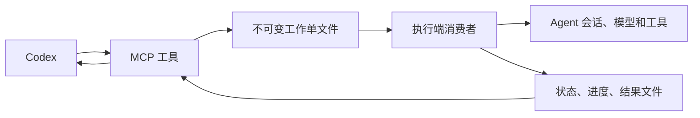

# Codex to Agents

**让 Codex 指挥 agents 干活。**

Codex 负责拆解任务、分配工作、跟进进度和验收结果，agents 负责执行具体任务并回传进度与结果。通过本地工作单连接指挥与执行，支持任务下发、进度追踪和继续追问。

架构、状态流转及官方接口说明见 [DESIGN.md](DESIGN.md)。

## 工作流程



## 当前接入

目前已接入 **DeepSeek Harness（DSH）桌面端**。其他 Agent 的接入需要实现对应的执行端适配，以下功能和操作说明基于当前 DSH 接入。

## 已实现

- DSH 离线时保存任务，重新加载消费者后继续领取。
- 指定目录或桌面项目、模型、推理档位创建执行会话。
- 对同一会话排队追问、插入补充要求、请求取消。
- 持久保存工作单状态和输出，按 DSH 的原生请求编号关联结果。
- 预先指定工作单编号，实现相同请求的幂等提交；编号与不同内容冲突时拒绝。
- 管理 DSH 桌面项目：查看、注册、改名、移除注册。
- 管理 DSH 桌面已有聊天：查看、改名、归档、恢复。
- 执行中断后先检查原生日志，不盲目重放投递结果不明的操作。

首版的模型选择使用 DSH 已配置的提供方。模型请求和工具执行都由 DSH 完成；本工程不读取或复制登录 token。模型白名单是提供方限制，任务提示中的修改范围仍需要 Codex 安排和验收，不能代替 DSH 工具权限或操作系统沙箱。

## 启用

要求 Node.js 22.19+、已登录且能正常使用模型的 DSH 桌面端，以及 Codex。已在 macOS 和 DSH 0.2.1-rc.2 上实机验证；其他版本需要重新验证官方控制器接口。

Codex 与执行端需使用同一个系统账户，数据目录需位于本机磁盘。

```bash
git clone https://github.com/heystarlink/codex-to-agents.git
cd codex-to-agents
nvm use 22.22.2
npm ci
node src/command.mjs enable --provider deepseek-account
node src/command.mjs status
```

默认数据目录是 `~/.codex-to-agents`，DSH profile 为 `desktop`。可使用 `--home`、`--profile`、`--directory` 覆盖。`--provider` 可用逗号分隔多个既有提供方 ID，不会自动创建或回退到其他模型提供方。

启用命令会备份 DSH 和 Codex 配置，追加本工程的 DSH 插件，并注册名为 `codex-to-agents` 的 MCP。重新打开 Codex 会话后使用工具。若 DSH 没有自动加载插件则重启 DSH。更改插件源码后应重启 DSH，避免 Node 的嵌套 ESM 模块缓存影响。

## 六个 MCP 工具

| 工具 | 用途 |
|---|---|
| `runtime_info` | 读取消费者心跳和最近一次模型目录快照 |
| `work_submit` | 保存模型执行工作单，立即返回编号 |
| `work_update` | 保存追问、插队或取消单，可引用原单或指定会话 |
| `work_inspect` | 读取单据状态、事件、结果，或查看最近单据 |
| `workspace_control` | 保存项目查看、注册、改名或移除操作 |
| `conversation_control` | 保存聊天查看、改名、归档或恢复操作 |

所有变更操作先返回工作单编号。项目和聊天列表也通过工作单获取，随后调用 `work_inspect` 读取输出。这使离线、重连和失败检查采用同一套规则。

`runtime_info` 的模型目录每 15 秒更新一次，心跳每轮更新；超过 6 秒未更新显示为离线。心跳是“最近有响应”的证据，不是正在执行任务的成功承诺。

## 示例

先查看 `runtime_info`，确定模型 ID。给 `work_submit`：

```json
{
  "goal": "在当前目录创建 HelloWorld.java，打印 Hello, World!，只修改这个文件。",
  "directory": "/absolute/path/to/project",
  "provider": "deepseek-account",
  "model": "deepseek-flash",
  "effort": "low",
  "title": "Java Hello World"
}
```

返回工作单编号后，使用：

```json
{ "order_id": "返回的 UUID" }
```

调用 `work_inspect`。`queued` 表示等待消费者，`dispatching` 表示正在交付控制操作，`executing` 表示已提交给 DSH，`completed` 表示已完成。`failed`、`blocked`、`cancelled` 保留对应终态；`uncertain` 表示执行中断或交付结果不明，需要先检查 DSH 和实际文件。管理操作不是跨系统事务，失败后也应核对是否已经产生部分变更。

首次提交前即可指定自己的 UUID 为 `order_id`。相同编号和相同参数只保存一次；若调用响应丢失，使用相同参数重试。不要换一个编号盲目重放不确定的操作。

继续原任务：

```json
{
  "target_order": "原工作单 UUID",
  "action": "append",
  "message": "补充一个参数校验。"
}
```

`interrupt` 对应 DSH 原生 steer，不能保证立即中断已经开始的工具调用。`cancel` 只请求取消当前活动，DSH 会保留排队消息。取消工作单完成仅表示取消请求已发出，原工作单的终态另行查看。

已有聊天可以直接使用 `conversation_id`。项目、归档等功能举例：

```json
{ "action": "list" }
```

交给 `workspace_control` 获取项目；

```json
{ "action": "archive", "conversation_id": "DSH 原生会话 ID" }
```

交给 `conversation_control` 归档聊天。运行中的聊天需要明确 `stop_running: true`；恢复使用 `action: "restore"`。移除项目注册保留文件和聊天历史。

## 停止

```bash
node src/command.mjs disable
```

该命令卸载消费者并移除 `codex-to-agents` MCP 注册，保留单据、文件和备份。**卸载消费者不取消 DSH 已接收的任务**；需要停止执行时，先提交取消操作，检查结果后再禁用。消费者停止期间的原生结果会在下次启动后从会话日志恢复。

## 验证

```bash
npm test
node scripts/desktop-check.mjs
```

自动测试覆盖文件发布、重复提交、消费者排他、任务恢复、模型白名单、原生参数、结果关联，以及真实 MCP stdio 通信。实机脚本会临时加载插件并发送少量真实 Flash 请求，测试实际文件和桌面管理；结束后卸载插件，不注册生产 MCP。报告存于 `.local/latest-check.json`，详细文件在其中指向的目录。

2026-10-18 的实机验证已通过：离线工作单领取、项目注册和改名、Flash 写文件、重复单复用、聊天改名和归档恢复、同会话追问、移除项目后保留文件。脚本结束时消费者已停止。

## 文件

| 文件 | 责任 |
|---|---|
| `src/orders.mjs` | 工作单契约、不可变请求发布、状态持久化 |
| `src/worker.mjs` | 单消费者、领取、恢复、进度轮询 |
| `src/desktop.mjs` | 官方 DSH 服务适配边界 |
| `src/extension.mjs` | DSH 插件生命周期 |
| `src/mcp.mjs` | Codex 使用的六个工具 |
| `src/command.mjs` | 启用、禁用、状态、stdio 启动 |

当前没有自动模型路由、自动合并代码和远程多机通信。调度多个会话时，由主控明确文件归属；跨模块并行可使用独立工作目录或 Git worktree。正式发布前应自行确定本工程的许可证并审核依赖许可。
